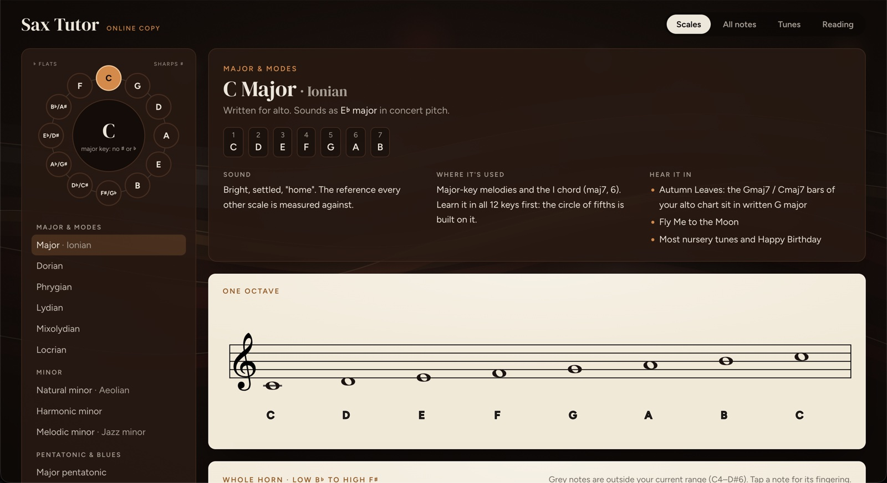
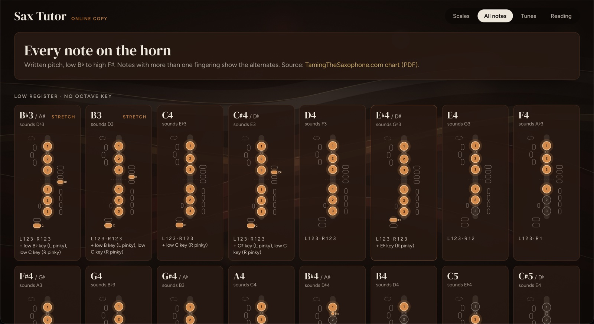

# Sax Tutor

A personal alto sax practice app: every fingering on the horn, scales from the circle of fifths across the whole range, my tune charts, and generated sight-reading. All notation is in **written alto pitch**.

**Open it:** https://sax.wo0.dev (any browser: laptop, work laptop, phone)





## What's in it

| Tab | What it does |
|---|---|
| **Scales** | Pick a key on the circle of fifths and one of 21 scales (major and modes, minors, pentatonics, blues, bebop, symmetric). Shows how it sounds, where it's used, songs that use it, the notes on the staff for one octave and the whole horn (low B♭ to high F♯), and a fingering for every note. |
| **All notes** | Every written note from low B♭ to high F♯, with alternate fingerings. |
| **Tunes** | My charts (Autumn Leaves, Smooth Operator, Naima, Happy Birthday) with chord symbols. Tap any note for its fingering, see every fingering the tune uses, open the original PDF. |
| **Reading** | Endless sight-reading exercises in the chosen key and scale. Play first; tap a note only if you need its fingering. |
| **Progress** | Tune milestones and which notes I look up most. *Mac only (see below).* |

## Two ways to use it

### Option 1: just open the link
https://sax.wo0.dev works in any browser with nothing to install. Everything works except saving progress. The Tunes tab asks for the sheet-music passphrase once per device.

### Option 2: set it up on your own Mac (to save progress and add music)
Only needed if you want to **save progress** (tune milestones, fingering lookups) or **add or change sheet music** on the site.

1. **Install Node 23.6 or newer:** `brew install node`
2. **Get the code:**
   ```bash
   git clone https://github.com/WO0O0O/SAX-APP.git
   cd SAX-APP
   ```
3. **Add a `sax` command** to `~/.zshrc` (use the folder you cloned into), then open a new terminal:
   ```bash
   alias sax='"$HOME/path/to/SAX-APP/bin/sax"'
   ```
4. **Add your sheet music** (not in git). Create `sheet-music/` in the project folder and put in:
   - the original PDFs (e.g. `autumn-leaves-easy.pdf`, `FingeringChart.pdf`);
   - the transcribed charts, `<tune-name>.tune.json` (format in [`src/music/chart.ts`](src/music/chart.ts); Claude can transcribe a PDF into one).
5. **Your progress database** (`data/sax.db`, not in git) is created automatically the first time you run `sax`. To carry progress over from another Mac, copy that machine's `data/` folder (or a backup from `npm run backup`) into the project before starting.
6. **Run it:** `sax`. It installs, builds, starts a local server and opens http://127.0.0.1:5757. Ctrl+C stops it.

| | Online link | Your Mac (`sax`) |
|---|---|---|
| Scales, All notes, Reading, Tunes | ✓ | ✓ |
| Progress tab, saved milestones and lookups | ✗ | ✓ in `data/sax.db` |
| Needs | A browser | Node + the steps above |

### Publishing sheet music to the site
The charts and PDFs are other people's arrangements, so the site only gets **encrypted** copies. After adding or changing anything in `sheet-music/` (needs push access to the repo):

```bash
npm run seal          # encrypts sheet-music/ into public/sealed/ (asks for the passphrase)
git add public/sealed && git commit -m "Update sheet music" && git push
```

The site redeploys automatically after the push.

## Development

| Command | What it does |
|---|---|
| `npm run dev` | API server (auto-restart) + Vite with hot reload at http://localhost:5173 |
| `npm run build` | Production build to `dist/` |
| `npm start` | Build, then serve on port 5757 |
| `npm test` | Unit tests (Vitest) |
| `npm run typecheck` | TypeScript check |
| `npm run seal` | Encrypt `sheet-music/` for the online copy |
| `npm run backup` | Copy the database to `data/backups/` (safe while running) |

Environment: `SAX_PORT` (default 5757), `SAX_DATA_DIR` (default `./data`).

## Layout

- `src/`: the React app (everything you see, plus the music theory and fingerings).
- `shared/`: code used by both browser and server (note spelling, transposition, encryption, tune list).
- `server/`: the Mac-only API and SQLite database.
- `vercel.json`: how the online copy is built and deployed on Vercel (every push to `main`).
- `public/sealed/`: encrypted sheet music for the online copy.
- `docs/`: start with [status.md](docs/status.md); [architecture.md](docs/architecture.md) explains how it all works; [sheet-music.md](docs/sheet-music.md) shows how a PDF becomes the interactive Tunes chart; [roadmap.md](docs/roadmap.md) has what's coming next.

Not in git: `data/` (my progress), `sheet-music/` (PDFs and charts), `node_modules/`, `dist/`.
