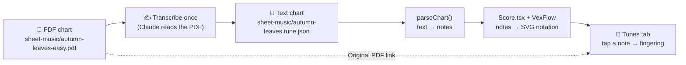
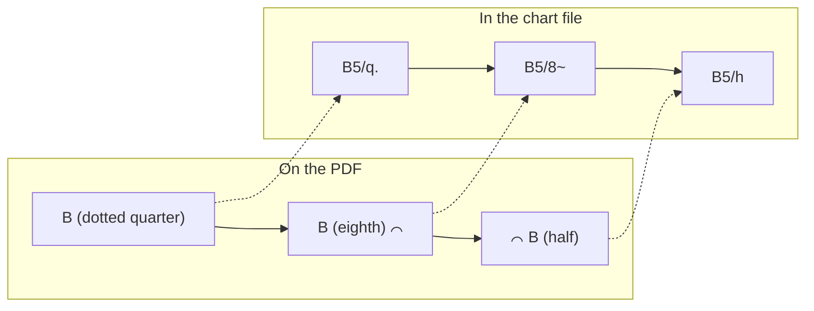
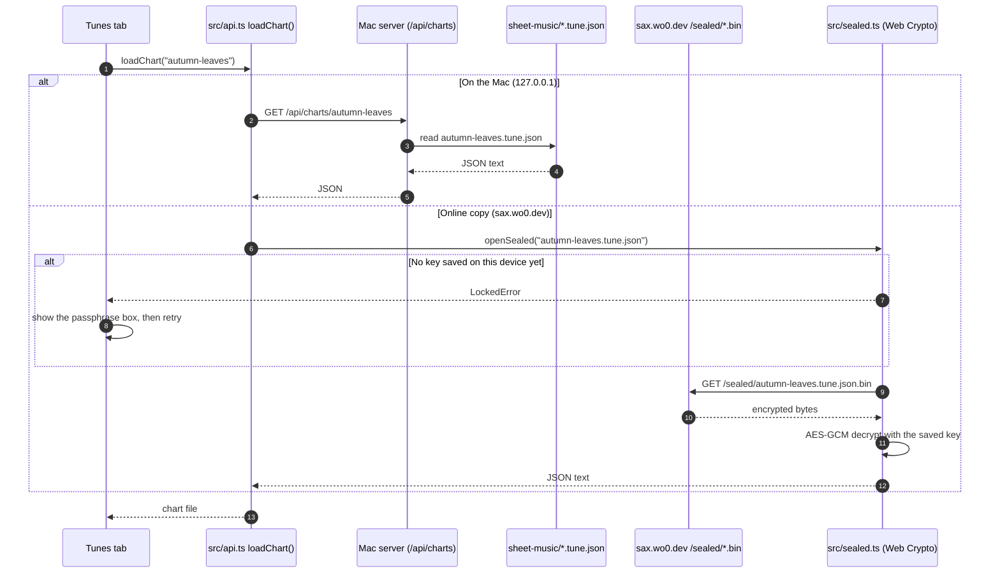
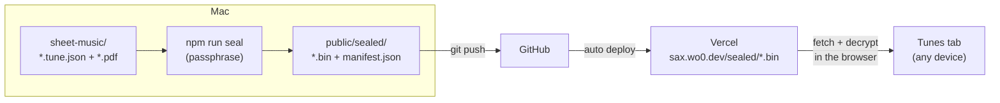
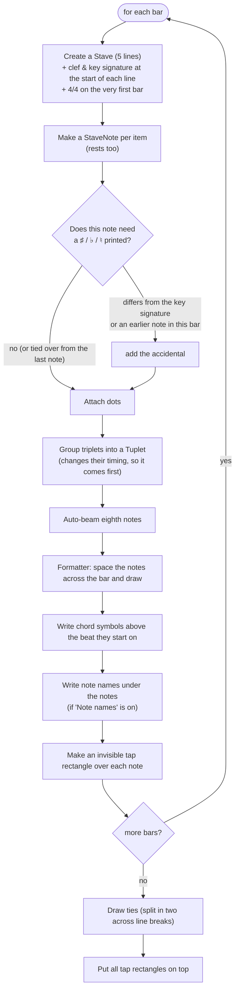
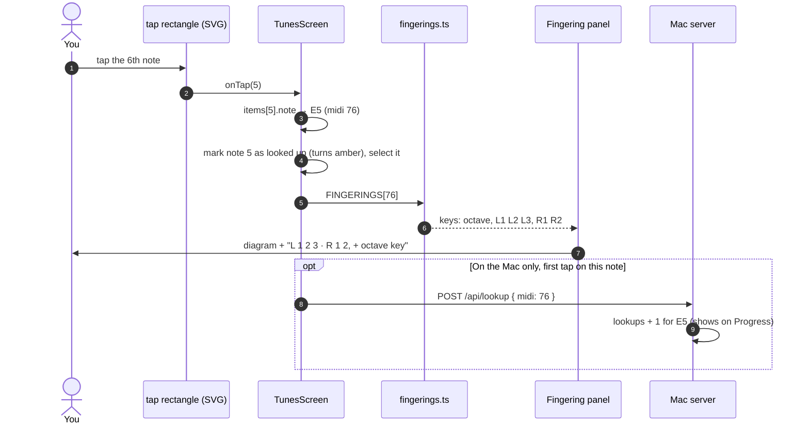
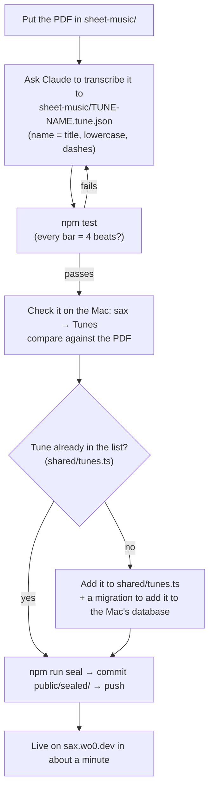

# From PDF to interactive sheet music (the Tunes tab)

How a chart PDF like `autumn-leaves-easy.pdf` becomes the tappable sheet music on the Tunes tab, where every note shows its fingering.

**The short version:** the app never reads the PDF. Each PDF is **transcribed once** into a small text file (`<tune>.tune.json`): one line per bar, describing notes, rhythms and chords. The app reads that file, works out the notes, draws them as real notation with VexFlow, and lays a tap target over every note. The PDF itself is only kept so you can open the original.



---

## 1. Why transcribe instead of reading the PDF?

Software that reads sheet music from images (optical music recognition) exists, but it's unreliable on small beginner charts like these. It confuses ties with slurs, misses triplet brackets, and misreads ledger-line notes, and every mistake would mean a wrong fingering. A beginner chart is only 10–35 bars, so transcribing it by hand is quick. A test then checks every bar adds up (§4), which catches most slips.

The text format is also useful in itself:
- you can read and fix it in a diff;
- it's tiny (Autumn Leaves is 2 KB);
- it can be encrypted for the online copy without involving PDFs at all.

## 2. The chart file

Each tune is one JSON file in `sheet-music/` (git-ignored, because these are other people's arrangements):

```json
{
  "title": "Autumn Leaves",
  "arranger": "Online Sax Academy, beginner alto chart",
  "writtenKey": "E minor / G major",
  "concertKey": "G minor / B♭ major",
  "pdf": "autumn-leaves-easy.pdf",
  "keySig": "G",
  "bars": [
    { "notes": "r/q E5/q F#5/q G5/q" },
    { "notes": "C6/w", "chords": ["Am7"] },
    { "notes": "r/q. D5/8 E5/q F#5/q", "chords": ["D7"] },
    { "notes": "B5/q. B5/8~ B5/h", "chords": ["Gmaj7"] }
  ]
}
```

| Field | Meaning |
|---|---|
| `keySig` | The key signature to draw, as a major key (`G` = one sharp, `F` = one flat). It also decides which accidentals need printing (§6). |
| `writtenKey`, `concertKey`, `arranger` | Shown in the tune's header. |
| `pdf` | Which file the "Original PDF" link opens. |
| `bars` | One entry per bar, in order. A pickup bar is written as a full bar starting with rests. |

### The note tokens
Each bar's `notes` is a space-separated list. One token per note or rest:

```
  F#5 / q . ~ 3
  ─┬─   ┬ ┬ ┬ ┬
   │    │ │ │ └─ 3  = part of a triplet (three of these fill the time of two)
   │    │ │ └─── ~  = tied to the next note
   │    │ └───── .  = dotted (half as long again)
   │    └─────── length: w whole · h half · q quarter · 8 eighth
   └──────────── written pitch with octave (C4 = middle C), or r for a rest
```

| Token | Means |
|---|---|
| `E5/q` | Quarter-note E, top space of the staff |
| `r/q.` | Dotted-quarter rest |
| `B5/8~` | Eighth-note B, tied into the next note |
| `C5/q3 D5/q3 E5/q3` | Quarter-note triplet: three notes in the time of two beats |
| `Ab5/8` | Eighth-note A♭ (`#` sharp, `b` flat; `##` / `bb` for doubles) |

**Chords** are a list per bar: `"Em"` starts on beat 1, `"A7@2"` starts on beat 3 (beats count from 0).

Pitches are always **written alto pitch**, exactly as printed on the alto part. The tokens describe what the notes *are*, not how they look: you write `F#5` even in G major, where the key signature already supplies the sharp. Working out what to print is the renderer's job (§6).

## 3. Transcribing a PDF

Done once per tune, by reading the PDF as an image (Claude does this when you ask). For each bar, write each note's pitch, length, any dot, tie or triplet, and the chord symbols above.

Here's bar 4 of Autumn Leaves (`Gmaj7`):



The tie mark (⌒) between the eighth and the half becomes `~` on the first of the two notes. Ties across bar lines work the same way: `A5/8~` at the end of one bar, then `A5/w` at the start of the next.

## 4. Checking the transcription

[src/music/chart.test.ts](../src/music/chart.test.ts) loads every chart it finds in `sheet-music/` and checks that:
- **every bar adds up to exactly 4 beats** (counting dots and triplets);
- every note is playable on the alto (low B♭ or higher).

A missing dot, a quarter written as a half, or a forgotten triplet mark changes a bar's length, so the test catches most transcription mistakes. It can't catch a wrong *pitch*; compare against the PDF while playing. The test skips itself where `sheet-music/` doesn't exist (for example on Vercel), because the charts aren't in git.

## 5. Getting the chart to the browser

The same function, `loadChart()` in [src/api.ts](../src/api.ts), loads a chart in both versions of the app, by two different routes:



For the online copy, `npm run seal` on the Mac encrypts each chart and PDF into `public/sealed/`, which is what gets pushed and deployed. How the encryption works and how strong it is: [architecture.md §7.6](architecture.md).



## 6. Turning text into notes ([src/music/chart.ts](../src/music/chart.ts))

`parseChart()` turns each token into a **`ScoreItem`**, the shape the renderer understands:

```ts
type ScoreItem = {
  note?: Note;          // undefined = rest
  duration: 'w' | 'h' | 'q' | '8';
  dots?: number;
  tie?: boolean;        // tied to the next item
  triplet?: boolean;
};
// Note = { letter: 3, acc: +1, octave: 5, midi: 78 }   ← F♯5
```

The key part is the `Note`, built by `parseNote()` in [shared/theory.ts](../shared/theory.ts). It keeps two things:
- **the spelling** (letter + accidental), so the score prints F♯ and not G♭;
- **the MIDI number** (78), which is what the fingering lookup uses, because the keys you press depend only on the sound.

## 7. Drawing the score ([src/notation/Score.tsx](../src/notation/Score.tsx))

[VexFlow](https://www.vexflow.com) draws music notation as SVG. `Score` goes bar by bar, four bars per line (two on a phone):



Three steps worth explaining:

- **Accidentals follow the real rules.** The key signature sets a default for each letter: in G major, every F is F♯ unless marked. An accidental then lasts until the end of the bar. The renderer keeps a small map of "current accidental for this letter and octave in this bar" and prints a sign only when a note differs from it. That's why `F#5` in G major prints with no sharp, while the `C#5 D#5` in the B7(♭9) bar print their sharps (C and D aren't sharp in G major). A note tied over from the previous one never repeats its sign.
- **Chord symbols land on the right beat.** For `A7@2`, the renderer adds up note lengths across the bar until it reaches beat 2, then writes the symbol above that note.
- **Tap targets sit on top.** Each note gets a transparent rectangle covering it, its ledger lines and its name. VexFlow adds invisible rectangles of its own that used to swallow the taps. CSS now makes everything VexFlow draws ignore the mouse (`.score svg * { pointer-events: none }`), and the tap rectangles are added last.

## 8. Tapping a note



Changing state (selected note, colours) makes `Score` redraw the SVG. That takes a few milliseconds for a 33-bar chart, which is simpler and quick enough compared with patching VexFlow's drawing in place.

Below the chart, **"Every note in this tune"** collects the distinct pitches from the chart (by MIDI number), sorts them low to high and shows a fingering card for each. It's a quick way to see every fingering the tune needs before you start.

## 9. Adding a new tune



The file name must match the tune's title as a "slug": `Smooth Operator` → `smooth-operator.tune.json`. That's how `loadChart` finds it.

## 10. Current limits

The renderer handles what the current charts need. A new chart might need more:
- **4/4 only:** the Tunes tab always passes `4/4`. `Score` itself takes any time signature.
- **One melody line.** No chords on the staff, no second voice.
- **No repeat signs, first/second endings, D.C./coda, dynamics, articulations or lyrics.** Charts that use them are written out in full.
- **No slurs.** Only ties (same pitch). A slur in the PDF can be left out; it doesn't change the notes or fingerings.
- **The key signature is set as a major key**, so a minor-key chart uses its relative major (E minor → `G`, D minor → `F`).
