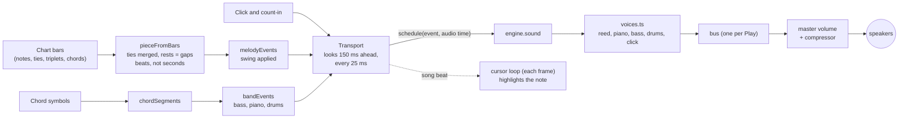
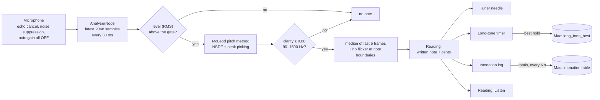

# Sound, ear training and the tuner

How the app makes sound, listens to the horn, and keeps both in time. Everything here runs in the browser: no sound files, no pitch-detection service, nothing uploaded. Start with the two diagrams, then dip into the part you need.

Related: [architecture.md](architecture.md) (the whole app), [roadmap.md](roadmap.md) (what was planned), [guide.md](guide.md) (how to use each tab).

---

## 1. Written pitch in, concert pitch out

The app **shows** written alto pitch and **plays** concert pitch. Alto sax sounds a major 6th below written, so one function does the conversion ([src/audio/pitch.ts](../src/audio/pitch.ts)):

```
written midi - 9 = concert midi        written C5 (72) → concert E♭4 (63) = 311.13 Hz
midiToHz(m) = 440 × 2^((m − 69) / 12)  written A4 → concert C4 = 261.63 Hz   (concert C = written A)
```

The tuner does the reverse (concert Hz → written note, +9). The same rule appears in `CLAUDE.md`, and tests pin the numbers at both ends of the horn (low B♭ sounds 138.59 Hz, high F♯ sounds 880 Hz).

## 2. From a chart to sound



**Events are in beats.** [src/audio/events.ts](../src/audio/events.ts) turns the chart's items into `{start, dur, midi, item}` using `beatsOf` (dots and triplets included). Tied notes of the same pitch become one held note. Tempo is applied only when scheduling, so changing it mid-play just moves the clock.

**Swing** ([swingBeat](../src/audio/events.ts)) delays off-beat eighths: the first eighth takes 50% of the beat (straight), 58% (light) or 67% (triplet swing). Only positions on the eighth-note grid move, so triplets stay put. The melody, the band's off-beat figures and the cursor all use the same function, so what you hear and what lights up agree.

**One quirk fixed on purpose:** a bar holding a single whole rest counts as a *full bar* in any time signature (12/8 is 6 beats), so later bars don't slip.

### The scheduler ([src/audio/transport.ts](../src/audio/transport.ts))

JavaScript timers are too loose for music, but the audio clock is sample-accurate. So a timer wakes every 25 ms and schedules everything that falls in the next 150 ms **on the audio clock**; the sound itself is then exact.

| Feature | How |
|---|---|
| Count-in | Clicks at virtual beats −N…−1, accent on the bar's first beat |
| Loop | Song beats `[start, end)` repeat; long notes are clipped at the loop end |
| Tempo change | Re-anchors the clock at the current beat, so there is no jump |
| Speed trainer | `onLoop` fires after each loop; every N loops the app adds 4 bpm |
| Robustness | The index moves on *before* scheduling, so one bad event can never stall the rest; an empty loop never reports loops |

The transport takes a fake clock in tests, so [transport.test.ts](../src/audio/transport.test.ts) checks exact timing without any audio.

### The cursor
The cursor is not a timer: every animation frame it reads the audio clock (minus the device's output latency), converts to a song beat and looks up the note sounding then. It is applied by toggling a CSS class on the note's tap target, so the score is **not redrawn** while playing.

## 3. The sounds ([src/audio/voices.ts](../src/audio/voices.ts))

All synthesised from oscillators and noise, so there is nothing to host. Each takes a `BaseAudioContext`, so the same code renders live or offline (that is how they were checked for silence, NaNs and level).

| Voice | Recipe |
|---|---|
| **Reed** (default) | Sawtooth → low-pass (cut-off follows the pitch, 600–2600 Hz) → 35 ms attack. A gentle vibrato fades in after about half a second. The cut-off idea is the iOS drone's. |
| **Piano** | Four partials (1, 2, 3, 4×) with a fast attack and an exponential decay that is shorter for higher notes. |
| **Bass** | Sine + triangle + a quiet octave through a 420 Hz low-pass. |
| **Comp** | The piano voice, shorter and softer. |
| **Click** | A decaying sine: 1800 Hz on the downbeat, 900 Hz otherwise (from the iOS metronome). |
| **Drums** | Kick: sine sweeping 130→48 Hz. Snare and hi-hat: filtered noise. Ride: band-passed noise plus two metallic partials. |

Exponential gain ramps can't aim at 0 (the browser throws), so every ramp targets a tiny positive floor; muted events are skipped before they reach a voice.

**Browser rules:** audio may only start after a tap (the first Play unlocks it). On iPhone the silent switch normally mutes web audio, so the engine sets `navigator.audioSession.type = 'playback'` where Safari supports it (16.4+); if not, flip the switch off.

## 4. The band ([src/audio/band.ts](../src/audio/band.ts))

Generated from the chart's chord symbols. Chords are *written* pitch (that is how the charts spell them); the band converts them to concert pitch. Everything is seeded, so a take repeats exactly until you press "New take".

| Style | Bass | Piano | Drums |
|---|---|---|---|
| **Swing** | Walking: root on the chord's first beat, chord tones in between (nearest to the last note), a half-step approach into the next chord's root | 3rd and 7th shells (sometimes the 5th) announce each chord, then comp on 2 and 4, or "Charleston" 30% of bars | Ride on every beat plus the swung skip note, hi-hat on 2 and 4, feathered kick |
| **Ballad** | Root, then the fifth, half notes | Soft rolled shells every two beats | Quiet ride and hi-hat |
| **Bossa nova** | Root / fifth pattern | Offbeat shells | Hi-hat eighths, kick on 1 and 3, soft rim on a clave |
| **Straight eights** | Root-driven eighths | Chops | Hi-hat eighths, kick, snare on 2 and 4 |

Bass stays in E1–E3 and the piano in a mid register. The last bar approaches the *first* chord, so a loop turns round smoothly. With "Melody" off you hear only the band and play the tune yourself.

## 5. Chord symbols ([shared/chords.ts](../shared/chords.ts))

`parseChord('F#ø7')` → root, quality, bass note and the chord tones spelled correctly (`F♯ A C E`). It reads the symbols as they appear in the charts (`Am7`, `DMaj7`, `B7(♭9)`, `E7#5♭9`, `C#m9/B#`, and a stacked `D (F#m)` reads as D). Compound degrees (9, 11, 13) reduce to their simple letter for spelling. From the tones come:

- **guide tones** (3rd and 7th; the 6th on a 6 chord) and `guideMoves`: for each guide tone of one chord, the nearest guide tone of the next (Am7→D7: the C stays, the G falls a half step to F♯);
- `guideLine`: one guide tone per chord, always the nearest, so the line moves in steps;
- `scaleFor`: which scale fits (m7 → Dorian, 7 → Mixolydian, maj7 → major or Lydian, ø7 → Locrian, 7♭9 → half-whole diminished, 7♯5♭9 → altered …), linked to the Scales tab;
- `transposeChordName`: moves the roots of a symbol when a tune is transposed.

The Tunes chart uses them to open the chord panel, to colour each melody note by its role over the chord under it, and (with the band) to know what to play.

## 6. The tuner



**The iOS app, ported.** Blue Note Tuner used AudioKit's YIN `PitchTap` with the `.measurement` audio mode (which turns off Apple's voice processing) and an amplitude gate. The browser does the same job: `getUserMedia` with `echoCancellation`, `noiseSuppression` and `autoGainControl` all **off**, a level gate, and a pitch detector. The detector is the **McLeod Pitch Method**, written out in [src/tuner/detect.ts](../src/tuner/detect.ts) (about 60 lines, nothing to install; it replaces the planned `pitchy` library and AudioWorklet, and an `AnalyserNode` is enough at this rate):

1. Compute the normalised square difference function for lags up to one period of 100 Hz.
2. Take the highest point of each positive stretch as a candidate.
3. Choose the **first** candidate within 7% of the highest. The shortest strong period is the fundamental, which is what protects against **octave errors** when the 2nd harmonic is loud, the classic sax trap.
4. A parabola through the winner gives a fractional lag, and that is what makes it accurate to a fraction of a cent.

Then [analysis.ts](../src/tuner/analysis.ts) smooths it: the **median of the last 5 frames** throws out a single octave glitch, and the displayed note only changes once the pitch is clearly closer to the next one (no flicker at ±50¢). Frequencies convert with your A4 reference (438–445 Hz).

**Tested without a horn.** The detector is a pure function, so [detect.test.ts](../src/tuner/detect.test.ts) feeds it synthetic tones: every written note from low B♭ to high F♯ at 44.1 and 48 kHz, as pure sines (within 1 cent) and as sax-like tones with strong upper harmonics, including one where the 2nd harmonic is *louder* than the fundamental (within 2 cents); ±10 cents detuned notes; light noise; silence and pure noise (rejected). It was also run end to end in a real browser with a fake microphone playing a recorded tone: *G in tune, then sharp 20¢, then flat 30¢* came out exactly.

### Long tones ([src/tuner/longtone.ts](../src/tuner/longtone.ts))
From `LongToneView.swift`. The timer runs while the note is held in tune (±12¢ casual, ±5¢ pro) and starts over once you have been out of tune, or silent, for **0.3 seconds**. A pressure bar fills over 30 s and warms from blue to red. A change of note starts a new hold. Your best hold per written note is kept on the Mac. (This times a *hold*, not a practice session; the app still has no timed sessions.)

### Intonation tendencies ([src/tuner/intonation.ts](../src/tuner/intonation.ts))
Once a note has been steady for 0.2 s, each frame adds its cents-off to that note's running total (notes off the horn are ignored). Totals are sent to the Mac every 6 s and on stop, where the server only keeps sums and counts. The Tuner tab and Progress show the average per note: e.g. "palm keys run +15¢ sharp".

### Reading that listens ([src/tuner/listen.ts](../src/tuner/listen.ts))
Replaces tapping to mark fumbles. For each expected note:

| You play… | What happens |
|---|---|
| the right note, steady for 0.12 s | the marker moves on (green if clean) |
| a wrong note, steady for 0.3 s | the expected note is marked fumbled; the marker waits |
| a repeated note | needs a gap in between (or another note) so one held note can't tick through three |
| a note more than 35¢ off | ignored: this checks *which note*, not intonation |

When the last note is played the result is saved (clean, looked up or fumbled per note) and feeds the next exercises.

## 7. Offline and the home screen

The online copy ships a small service worker ([public/sw.js](../public/sw.js)). The build ([vite.config.ts](../vite.config.ts)) lists every file in `dist/` in `precache.json` and stamps the worker with a fingerprint of them; on install the worker downloads them all, **sealed sheet music included** (it is already encrypted). After the first visit the app works with no connection. Pages use the network first (so a new deploy shows up) and fall back to the saved copy; files come from the saved copy. The worker keeps the previous build's cache too, so a tab left open across a deploy can still load its lazy files. The Mac version never registers it. [manifest.webmanifest](../public/manifest.webmanifest) and the icons let phones add it to the home screen.

To install on iPhone: open https://sax.wo0.dev in Safari, Share, **Add to Home Screen**. The tuner, sound and recording all work from there.

## 8. Known limits

- Pitch detection is for one note at a time (a sax is monophonic). Chords or a loud room will confuse it; the sensitivity slider sets the level gate.
- The microphone hears the speakers: use headphones when the drone, a backing track or playback is sounding while the tuner or Listen is on.
- Reading's Listen checks the note, not the rhythm.
- Backing tracks are generated and simple. If they ever sound too thin, a small sample kit is the next step.
- Not yet tried on an actual horn in a room (only synthetic and recorded tones): the first thing to check is the sensitivity slider, and the in-tune zone at Pro (±5¢) may feel strict.
